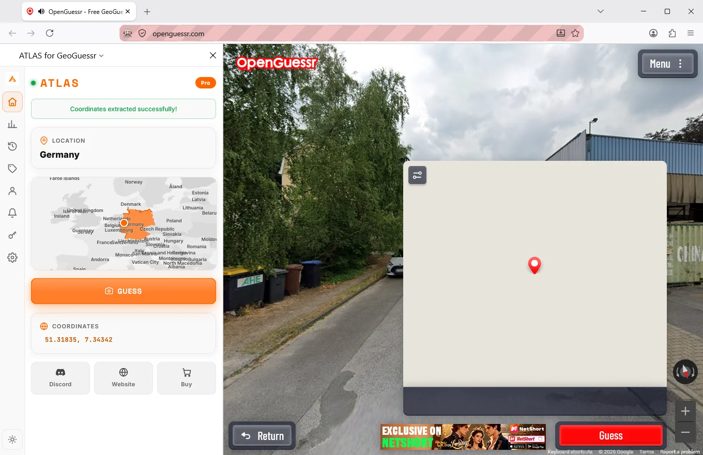

# ATLAS for Firefox

The ATLAS sidebar, published on Firefox Add-ons, for Firefox 128 and newer.

It reads the round you have open, tells you which country you are looking at and
where inside it, and puts the pin on the map. Seven rounds cost nothing and need
no account.

Get it: **[addons.mozilla.org](https://addons.mozilla.org/en-US/firefox/addon/geoguesser-cheats-hack/)**

---

## New in v1.7

Firefox users spent a long time being told to open Chrome. That ended with the
v1.7 release in August 2026, when the add-on went live on Firefox Add-ons. It is
the same build people already knew from the other browser, and the same key
unlocks it.

## Identical to the Chrome version

- the location card: country, region or town, direction
- the coordinates, which you can verify yourself after the round
- the pin, dropped on the map for you
- seven free rounds before anything is asked of you
- one key across every ATLAS platform

## One difference, and we would rather you read it here than discover it

**Pressing Guess is Chrome only for now.**

In Firefox the pin lands where it should, and then you press the button. The
hands free path where the extension submits and pulls up the next round has not
shipped on this browser yet.

Everything else behaves the same. If that one button matters to you today, the
[Chrome version](https://github.com/Sven233333/atlas-geoguessr-chrome-extension)
has it, and your key already covers both.

## Requirements

| | |
|---|---|
| Firefox | 128 or newer |
| Operating system | Windows, macOS or Linux desktop Firefox |
| Account | Not needed for the free rounds |
| Key | Shared with the Windows app and the phone apps |

Running Firefox on a Mac is a supported, ordinary case rather than a workaround.
The Mac situation in full:
[atlas-geoguessr-macos](https://github.com/Sven233333/atlas-geoguessr-macos).

## Installing

1. Open the [Firefox Add-ons listing](https://addons.mozilla.org/en-US/firefox/addon/geoguesser-cheats-hack/).
2. Add it to Firefox and allow it in the sidebar.
3. Open a round, open the sidebar.
4. Seven rounds later, decide whether you want a key.

## Questions

**Why is it not on the Mozilla listing under the ATLAS name?**
The store slug was set when the listing was first published and changing it would
break every existing link to it. The add-on itself is ATLAS.

**Does Firefox get predictions as accurate as Chrome?**
Yes. It is the same prediction on the same picture. The browser has nothing to do
with the answer, only with what happens after it.

**Will the guess button arrive in Firefox?**
It is the obvious next thing for this add-on. Release notes appear at
[geoguessrcheats.com/blog](https://geoguessrcheats.com/blog).

**Is there a Firefox version of the unattended bot?**
No, and there will not be one. Playing whole sessions on its own is a desktop job:
[atlas-geoguessr-windows-app](https://github.com/Sven233333/atlas-geoguessr-windows-app).

**Does it read the page I am on?**
It works from the round in front of it and it does not touch anything else you
have open.

## Elsewhere

- Everything in one place: [Atlas-geoguessr-bot](https://github.com/Sven233333/Atlas-geoguessr-bot)
- Platform comparison: <https://geoguessrcheats.com/platforms>
- Prices: <https://geoguessrcheats.com/plans>

## Disclaimer

Independent project, unaffiliated with GeoGuessr AB and with Mozilla. Assistants
may be forbidden by the rules of whatever you are playing. Check them.
